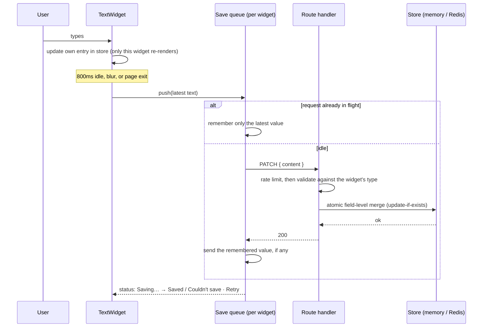

# Pods: Digital Sales Rooms

A small product in the spirit of Trumpet: sellers build **pods** (personalised
microsites for a buyer) out of **widgets**, then share one link.

The core of the challenge is the **text widget**:

- add as many as you like,
- each one has a border and its own independent text,
- it saves to the backend when you stop typing,
- everything comes back after a refresh.

On top of that, and clearly separated below, are the product features that make
it feel real:

- a pods dashboard,
- image widgets with uploads,
- drag-and-drop reordering,
- a read-only buyer link with view counts,
- duplicating a pod as a template.

It runs locally with **no setup beyond `npm install`**: no database, accounts or
environment variables. Built with Next.js 16 (App Router), React 19, TypeScript,
Zod and dnd-kit. Tested with Vitest, React Testing Library and Playwright.

---

## Contents

- [Quick start](#quick-start)
- [Running the tests](#running-the-tests)
- [Requirements checklist](#requirements-checklist)
- [Product features beyond the brief](#product-features-beyond-the-brief)
- [How it works](#how-it-works)
- [Approach and key decisions](#approach-and-key-decisions)
- [Efficiency](#efficiency)
- [Trade-offs](#trade-offs)
- [What I would do with more time](#what-i-would-do-with-more-time)
- [Deployment](#deployment)
- [Use of AI](#use-of-ai)

---

## Quick start

Requirements: **Node.js 22+** and npm.

```bash
npm install
npm run dev
```

Open http://localhost:3000, click **+ New pod**, then add widgets with
**+ Text** or **+ Image**. Data is kept in memory, so restarting the server
starts fresh.

### With Docker

```bash
docker compose up --build
```

Then open http://localhost:3000. The image is a multi-stage build of Next.js's
standalone output, running as a non-root user with a health check.

### Optional: Redis storage

Copy `.env.example` to `.env.local` and fill in your Upstash credentials. The
app switches to Redis automatically when they are present.

## Running the tests

| Command                        | What it runs                                                                                          |
| ------------------------------ | ----------------------------------------------------------------------------------------------------- |
| `npm test`                     | All unit, component and API integration tests (Vitest, ~2s)                                           |
| `npm run test:watch`           | Same, in watch mode                                                                                   |
| `npm run test:e2e`             | Playwright end-to-end tests against a production build (first run: `npx playwright install chromium`) |
| `npm run lint`                 | ESLint (Next.js + React Compiler rules)                                                               |
| `npm run typecheck`            | TypeScript in strict mode                                                                             |
| `docker build --target test .` | Lint, type check and unit tests inside Docker                                                         |

**Test suite:** 185 unit, component and API tests plus 11 end-to-end tests.
Another 18 Redis integration tests run when `UPSTASH_REDIS_REST_URL` and
`UPSTASH_REDIS_REST_TOKEN` are set; they reuse the exact contract suites the
in-memory adapters pass. GitHub Actions runs everything on each push (see
[`.github/workflows/ci.yml`](.github/workflows/ci.yml)).

## Requirements checklist

| Requirement                                      | Where / how                                                                                                                                           |
| ------------------------------------------------ | ----------------------------------------------------------------------------------------------------------------------------------------------------- |
| Add one or more text widgets with a button       | **+ Text** ([`WidgetBoard.tsx`](src/features/widgets/components/WidgetBoard.tsx))                                                                     |
| Each widget has a border                         | Reusable [`Card`](src/shared/ui/card/Card.tsx), via the shared [`WidgetFrame`](src/features/widgets/components/WidgetFrame.tsx)                       |
| Reusable components (inputs, buttons…)           | [`src/shared/ui`](src/shared/ui): `Button`, `TextArea`, `TextInput`, `Card`, `SegmentedControl`, `Toast`, `EmptyState`, `CopyButton`, `ConfirmButton` |
| Text is not shared between widgets               | Normalised store, one subscription and one autosave lifecycle per widget; tested                                                                      |
| Sent to the backend when the user is done typing | Debounced autosave (800ms idle), immediate save on blur, `keepalive` save on page exit                                                                |
| Same widgets and text after refresh              | Editor server-renders saved widgets; e2e tests reload the page, including mid-typing                                                                  |
| Large strings (1,000+ characters)                | Up to 10,000 characters, validated on the server; tested at 1,000, 10,000 and 10,001 characters                                                       |
| Unit tests                                       | Vitest + React Testing Library + API integration tests, plus Playwright e2e                                                                           |
| README, approach, version control                | This file; small, conventional commits                                                                                                                |
| **Bonus:** delete widgets                        | Delete with a 5-second **Undo**                                                                                                                       |
| **Bonus:** Docker                                | `Dockerfile` + `docker-compose.yml`                                                                                                                   |
| **Bonus:** trade-offs and future work            | [Trade-offs](#trade-offs), [More time](#what-i-would-do-with-more-time)                                                                               |
| **Bonus:** extra features                        | See [Product features beyond the brief](#product-features-beyond-the-brief)                                                                           |

## Product features beyond the brief

| Feature                       | What it does                                                                                                            |
| ----------------------------- | ----------------------------------------------------------------------------------------------------------------------- |
| **Pods dashboard** (`/`)      | Your inventory of pods: title, buyer, widget count, buyer views and last edited, most recent first                      |
| **Pod details**               | Editable title and "Prepared for" buyer name, autosaved with the same hook as widgets                                   |
| **Image widgets**             | Upload by picking or dropping a file (PNG/JPEG/GIF/WebP, up to 2 MB), with autosaved alt text and caption               |
| **Reordering**                | Drag by the handle, or use the keyboard (Space + arrow keys on the handle, or the ↑ ↓ buttons); every move is announced |
| **Buyer link** (`/share/:id`) | Read-only, server-rendered page with no editor chrome; a separate id that never reveals the editing URL                 |
| **View counts**               | Each buyer view is counted and shown on the dashboard and in the editor                                                 |
| **Preview as buyer**          | See the pod exactly as the buyer link renders it, without leaving the editor                                            |
| **Duplicate pod**             | Copy a pod, widgets and images included, as a template for the next buyer                                               |
| **Delete pod**                | Two-step confirm; removes its widgets, images and buyer link                                                            |

## How it works

### Project structure (feature-sliced)

```
src/
├── app/                          # Next.js routing only: thin files, no business logic
│   ├── page.tsx                  # Dashboard
│   ├── pods/[podId]/page.tsx     # Editor: static shell + server-streamed pod
│   ├── share/[shareId]/page.tsx  # Buyer view
│   └── api/…/route.ts            # One-line route handlers
├── features/
│   ├── pods/                     # Pods: model, storage, service, dashboard and editor header
│   │   ├── domain/  server/  api-client/  components/
│   └── widgets/                  # Widgets and images
│       ├── domain/               # Zod schemas (text | image union), limits, API contract
│       ├── server/               # Repository + image store ports/adapters, services, HTTP
│       ├── api-client/           # Typed fetch client
│       ├── state/                # Fine-grained widget store, local drafts
│       ├── hooks/                # useWidgetBoard: add, save, reorder, upload, delete
│       └── components/           # WidgetFrame, TextWidget, ImageWidget, SortableWidgetList, PodContent…
├── server/container.ts           # Composition root: picks adapters, wires features via ports
├── proxy.ts                      # Real 404s for unknown pod and buyer links
└── shared/                       # Feature-agnostic building blocks
    ├── ui/                       # Reusable components
    ├── hooks/use-autosave.ts     # Generic debounced, crash-safe autosave
    ├── lib/save-queue.ts         # Latest-wins serial save queue
    └── server/                   # HTTP helpers, route wrapper, rate limiting, Redis config
```

`pods` and `widgets` never import each other. Each declares a small **port**
(an interface) for what it needs from the other, such as "does this pod
exist?" or "copy this pod's content". The composition root in
[`src/server/container.ts`](src/server/container.ts) wires them together.
Server-only modules import `server-only`, so they cannot leak into the browser
bundle. Route files are one-liners over framework-agnostic handlers, which is
why the whole API is tested with plain `Request` objects.

### REST API

| Method   | Path                                 | Description                                                |
| -------- | ------------------------------------ | ---------------------------------------------------------- |
| `GET`    | `/api/pods`                          | Dashboard list with widget counts and view stats           |
| `POST`   | `/api/pods`                          | Create a pod                                               |
| `GET`    | `/api/pods/:podId`                   | Get a pod                                                  |
| `PATCH`  | `/api/pods/:podId`                   | Update title and/or buyer name (field-level merge)         |
| `DELETE` | `/api/pods/:podId`                   | Delete a pod with its widgets and images (idempotent)      |
| `POST`   | `/api/pods/:podId/duplicate`         | Copy a pod, widgets and images                             |
| `GET`    | `/api/pods/:podId/widgets`           | List widgets in display order                              |
| `PUT`    | `/api/pods/:podId/widgets/:widgetId` | **Idempotent** create (201 created, 200 already existed)   |
| `PATCH`  | `/api/pods/:podId/widgets/:widgetId` | Partial update, validated per widget type (404 if deleted) |
| `DELETE` | `/api/pods/:podId/widgets/:widgetId` | Delete (idempotent, 204)                                   |
| `POST`   | `/api/pods/:podId/images`            | Upload an image (multipart `file`)                         |
| `GET`    | `/api/images/:imageId`               | Serve an image (immutable cache headers)                   |
| `POST`   | `/api/share/:shareId/views`          | Count a buyer view (beacon; always 204)                    |
| `GET`    | `/api/health`                        | Health check, including which storage is in use            |

Errors share one shape: `{ "error": { "code", "message", "details?" } }`.

| Code                   | Status | Notes                      |
| ---------------------- | ------ | -------------------------- |
| `VALIDATION_ERROR`     | 400    |                            |
| `INVALID_IMAGE`        | 400    |                            |
| `NOT_FOUND`            | 404    |                            |
| `POD_NOT_FOUND`        | 404    |                            |
| `WIDGET_LIMIT_REACHED` | 409    |                            |
| `POD_LIMIT_REACHED`    | 409    |                            |
| `PAYLOAD_TOO_LARGE`    | 413    |                            |
| `RATE_LIMITED`         | 429    | Sent with `Retry-After`    |
| `INTERNAL_ERROR`       | 500    | Details hidden, and logged |

### The save path



## Approach and key decisions

I treated this as a small product rather than a form. The brief hides a few
real engineering problems, and most of the design follows from solving them
properly. The product features reuse the same building blocks rather than
adding new mechanisms.

### 1. "When the user is done typing" is a saving problem, not a timer

- **Debounce (800ms idle)** turns one request per keystroke into roughly one
  per pause. **Blur** saves immediately.
- **One request in flight per widget** ([`save-queue.ts`](src/shared/lib/save-queue.ts)).
  Edits made during a request are coalesced, and only the newest is sent next.
  Responses can never arrive out of order and overwrite new text with old
  text, a bug a plain `setTimeout` + `fetch` has. The same queue also
  serialises reorder saves.
- **Retries with exponential backoff** for network errors, timeouts, 429 and
  5xx only. A newer edit cancels a pending retry rather than queueing behind it.
- **Visible status** per widget: _Unsaved changes → Saving… → Saved_, or
  _Couldn't save · Retry_. The browser only asks for confirmation before
  leaving when a save has actually failed.
- **One hook for everything:** [`useAutosave`](src/shared/hooks/use-autosave.ts)
  saves text, image alt text and captions, and the pod's title and buyer name.

### 2. Refreshing immediately after typing must not lose text

When a page is reloaded, the browser requests the new page **before** it fires
`pagehide` on the old one. So a final save sent from `pagehide` can reach the
server after the refreshed page has already been rendered with the old text. I
hit this while testing in a real browser and fixed it in two layers:

1. Exit saves are sent on `beforeunload`, which runs before the reload request,
   with `fetch(…, { keepalive: true })` so they outlive the page.
2. As the guarantee, unsaved text is also written synchronously to
   `sessionStorage` on exit. When the page loads, any draft the server doesn't
   have yet is restored and saved again ([`drafts.ts`](src/features/widgets/state/drafts.ts)).

A Playwright test reloads the page mid-debounce to prove it.

### 3. Widgets are truly independent

- State is normalised: an ordered id list plus a map of widgets
  ([`widget-store.ts`](src/features/widgets/state/widget-store.ts)).
- The list subscribes to the id list only, and each widget to its own entry via
  `useSyncExternalStore`. Typing in one widget re-renders that widget and
  nothing else; a test asserts this.
- Each widget owns its own autosave queue, so timers, retries and statuses are
  never shared.

### 4. Every write is race-free

- **Client-generated ids + idempotent `PUT`.** New widgets appear instantly
  (optimistic UI). A retried create returns the existing widget instead of
  making a duplicate. If the server rejects it, the widget is rolled back and
  an error is shown.
- **Saves wait for the create.** The first edits to a brand-new widget cannot
  overtake its creation request.
- **Field-level, atomic merges.** `PATCH` merges only the fields sent, inside
  one atomic operation (a Redis Lua script, or a single synchronous step in
  memory). A reorder (`position`) and a text save (`content`) on the same
  widget therefore never overwrite each other.
  - Manual testing caught exactly this bug on **pods**. Title and buyer name
    autosave separately, and the first version did a read-modify-write of the
    whole pod, so the buyer name was sometimes lost.
  - Pods now use the same atomic patch, and a regression test covers it.
- **Updates never resurrect deleted widgets.** `PATCH` is update-if-exists, so
  a late autosave after a delete gets a 404 instead of recreating the widget.
- **Undoable delete.** The widget disappears immediately; the `DELETE` is sent
  after a 5-second undo window, or straight away if the page is closed.

### 5. Reordering that writes one record

Widgets carry a [fractional index](https://github.com/rocicorp/fractional-indexing)
`position` such as `a0` or `a0V`. Moving a widget gives it a key between its
new neighbours, so a move rewrites **one** widget, never the whole list.

- **Two ways to move:**
  - Drag by the handle. The handle is separate from the text, so selecting text
    still works.
  - Or use the keyboard: Space on the handle picks the widget up, or use the
    ↑ ↓ buttons.
- **Accessible:** focus stays on the control that moved the widget, and every
  move is announced to screen readers.
- **Undo is position-aware:** an undone delete is reinserted by its key, so it
  lands in the right place even if other widgets moved in the meantime.

### 6. Images, handled like user uploads should be

- **The format is detected from the file's bytes, not trusted from the client.**
  The magic bytes decide the type; the browser's declared type and the file
  extension are ignored.
- **SVG is rejected**, because it can carry scripts.
- **Served safely:** images are served with `X-Content-Type-Options: nosniff`,
  a restrictive `Content-Security-Policy`, and immutable caching (image ids
  never change).
- **No edit id in image URLs:** URLs are keyed by image id only, so the buyer
  page never exposes the pod's editable id.
- **Cleanup:** replacing or removing an image deletes the old file, and
  deleting a pod deletes all of its images.

### 7. A buyer link that's safe to send

- **Separate share id:** the buyer link uses a separate, unguessable share id,
  so a buyer can't derive the editor URL.
- **Private by default:** the page is server-rendered without editor controls,
  marked `noindex`, and sends no referrer.
- **Accurate view counts:** views are recorded by a small client beacon once the
  page has actually loaded.
  - Counting during server rendering over-counted: under partial prerendering
    the component can render more than once per request.
  - It would also count link-preview bots.
  - The beacon endpoint always returns 204, so it reveals nothing about which
    links exist.

### 8. Storage behind ports, chosen by the environment

Every repository has two adapters that pass the **same contract test suite**:
pods, widgets and images.

- **In memory** (default; local, tests, Docker): plain `Map`s. Kept on
  `globalThis` so Next.js hot reloads don't silently wipe them in development.
- **Upstash Redis** (used automatically when credentials exist):
  - pods and widgets in hashes,
  - conditional writes and field merges as atomic Lua scripts,
  - views counted with `HINCRBY`,
  - every read validated with Zod.

### 9. Next.js used deliberately

- **REST route handlers instead of Server Actions.** The HTTP contract stays
  explicit and testable, and `keepalive` page-exit saves need a plain `fetch`.
- **Server-rendered data:** the dashboard, editor and buyer page render their
  data on the server (Cache Components, with `Suspense`-streamed content). A
  refresh shows content immediately, with no spinner-then-fetch.
- **Real status codes:** pages stream their shell immediately, which fixes the
  status at 200 before a lookup inside the page could run. A small
  [`proxy.ts`](src/proxy.ts) checks the pod or share id first, so unknown or
  deleted links return a true **404** (not a "soft 404") while real pods keep
  the instant shell. The check is a single key read.

### 10. Limits and protection

- **10,000 characters per text widget** (the requirement is 1,000). The cap
  keeps the worst-case UTF-8 body (~40 KB) under the 64 KB browser limit for
  `keepalive` requests, which the page-exit save depends on.
- **Count limits:** 50 widgets per pod and 100 pods, both enforced atomically.
- **Size limits:** 64 KB JSON bodies and 2 MB images, both checked before
  parsing.
- **240 requests per minute per IP**, in memory locally or as a Redis sliding
  window when deployed.

### 11. Accessible and minimal

- **Labels:** every control is labelled. Image widgets prompt for alt text, and
  an image with empty alt text is treated as decorative.
- **Announcements:** save status, toasts and reorder moves are announced through
  polite live regions.
- **Visual accessibility:** visible focus rings, dark mode and
  `prefers-reduced-motion` support.
- **Minimal styling, as the brief asks:** CSS modules and a few design tokens,
  no UI framework.

## Efficiency

| Operation    | Client                                  | Server (memory)  | Server (Redis)                         |
| ------------ | --------------------------------------- | ---------------- | -------------------------------------- |
| Keystroke    | O(1): one widget re-renders, no network | –                | –                                      |
| Save         | ≤ 1 in flight + 1 pending per widget    | O(1) merge       | O(1), one Lua call                     |
| Reorder      | O(n) id-list update (n ≤ 50)            | O(1): one widget | O(1): one widget                       |
| Load pod     | Server-rendered, no extra round trip    | O(n log n) sort  | One `HGETALL` + sort                   |
| Dashboard    | Server-rendered                         | O(P log P)       | `HGETALL` + one pipelined `HLEN` batch |
| Count a view | One beacon per page load                | O(1)             | O(1) `HINCRBY`                         |

Network efficiency matters more here than CPU:

- Debouncing and coalescing cut a 100-keystroke burst from 100 requests to 1
  or 2.
- Each request carries only the changed fields.
- Unchanged values are detected on the server, which skips the write.

## Trade-offs

- **In-memory storage by default.** It needs zero setup, which matters most for
  reviewers. The cost is that data is lost when the server restarts. Redis
  covers real deployments with no code changes.
- **Redis instead of Postgres.** The data is small and key-value shaped, so
  hashes are the simplest durable store, with no schema or migrations. With
  users, permissions and analytics I would use Postgres as the main database
  and keep Redis for caching and rate limiting.
- **Images live in the same store (base64 in Redis).** That's fine at 2 MB per
  image for a demo. At scale they belong in object storage (S3 or R2) behind a
  CDN, with resizing.
  - An image that was uploaded but never attached (for example, the tab closed
    mid-upload) stays until its pod is deleted.
- **No authentication: one shared workspace.** Anyone who can open the app sees
  every pod. Buyer links are unguessable but bearer-style.
- **Last write wins per field.** Two tabs editing the same field overwrite each
  other. Different fields are safe.
- **View counts are page loads.** A seller clicking **Open** counts too; there
  is no unique-visitor logic.
- **800ms debounce.** Longer means fewer requests but a bigger window of
  unsaved text. Blur, page-exit saves and drafts cover that window.
- **Delete is committed after a 5-second undo window.** That makes Undo instant
  and needs no restore endpoint. If the page is killed abruptly, a pending
  delete may not reach the server and the widget reappears. That's the safe
  direction to fail.
- **dnd-kit for drag and drop.** It's a dependency, but writing an accessible
  sortable list by hand (pointer, touch, keyboard, announcements) is not a good
  use of time.

## What I would do with more time

1. **Auth and workspaces:** sellers own pods; buyer links get optional email
   gating and expiry.
2. **Object storage for images:** S3 or R2 with signed uploads, resizing and
   responsive `srcset`.
3. **Real engagement analytics:** unique viewers, time on page, which widgets
   were read. This is what Trumpet sells.
4. **Optimistic concurrency:** a `version` per widget with `If-Match` / 409, plus
   `BroadcastChannel` to keep multiple tabs in sync.
5. **More widget types:** video, documents, mutual action plans. Each is a new
   member of the `type` union plus a component, and gets reordering, deletion
   and the buyer view for free from `WidgetFrame` and `PodContent`.
6. **Rich text and collaboration:** a CRDT such as Yjs so several sellers can edit
   at once.
7. **Postgres** behind the same repository ports, with migrations.
8. **Observability:** structured logs, request ids, and error tracking such as
   Sentry.

## Deployment

Not required to run or review the project. To deploy it on **Vercel**:

1. Import the GitHub repository into Vercel. The framework is detected
   automatically.
2. In the project's **Storage** tab, add **Upstash Redis** from the Marketplace.
   Vercel injects `KV_REST_API_URL` and `KV_REST_API_TOKEN`, which the app reads.
3. Redeploy. `GET /api/health` should report `"storage": "redis"`.

Serverless platforms need step 2: each request may hit a different instance,
so in-memory storage would not persist. Self-hosting the Docker image works
with in-memory storage as-is.

## Use of AI

I built this with **Claude Code** (Anthropic) as a pair programmer. I set the
direction and made the product and architecture decisions:

- Next.js in a single repo.
- Upstash Redis as the optional serverless store, chosen over Neon and Supabase.
- A feature-sliced folder structure.
- No live demo, so reviewers can run everything with zero setup.
- Which product features to add: real image uploads, drag plus keyboard
  reordering, buyer view counts and pod duplication.

The AI proposed implementation options and wrote most of the code, which I
reviewed. Every behaviour is backed by tests, and I checked the app manually in
a real browser. Those manual checks found two real bugs that are now fixed and
covered by tests:

- the reload race (decision 2),
- the lost title or buyer name (decision 4).

### How the AI was directed

The work ran as a conversation with the AI. Below is a structured summary of
the instructions it was given, grouped by phase, followed by example prompts
showing how each phase is directed.

**1. Framing and planning**

- **Context:** the full challenge brief and its evaluation criteria.
- **Role:** act as a senior product engineer taking the assessment.
- **Goal:** meet every requirement first, then add the depth that separates a
  senior submission: correctness under real-world conditions, not just the
  happy path.
- **Output:** a plan covering architecture, data flow, testing strategy and
  scope, reviewed with me before any code was written.

**2. Architecture constraints**

- **Single repo:** one Next.js codebase for frontend and backend, using route
  handlers as an explicit REST API.
- **Structure:** feature-sliced, with pods and widgets as independent slices
  and shared UI and utilities kept apart.
- **Storage:** in-memory by default, so reviewers run the project with zero
  setup. Upstash Redis sits behind the same interface as an optional backend,
  chosen over Neon and Supabase after comparing free tiers and idle behaviour.
- **Deployment:** no live demo; the deliverable is the repository.
- **Scope check:** list all non-functional requirements (tests, README,
  version control, submission) alongside the features.

**3. Implementation**

- **Commits:** small, conventional commits from the first scaffold.
- **Tests:** a unit testing framework at every layer, plus end-to-end tests
  for the behaviour the brief cares most about, persistence across refresh.

**4. Product depth**

- **Product research:** explain the purpose of a pod in Trumpet's product, then
  shape features around it.
- **Seller and buyer:** add a buyer preview so the seller sees what the buyer
  will see.
- **Extensions:** extend from a single page to a small product: a pods
  dashboard, buyer share links with view counts, image uploads, widget
  reordering and pod duplication.
- **Decisions at each fork:**
  - real file uploads over pasted URLs,
  - drag and drop with keyboard alternatives over buttons only,
  - view counts and duplication as the engagement and template features.

**5. Review and verification**

- **Manual checks:** run the app in a real browser after each phase, alongside
  the automated suites.
- **Bugs become tests:** treat every bug found manually as a missing test. The
  reload race and the lost title or buyer name were both fixed that way.
- **Final audit:** confirm the solution against the brief's requirements and
  bonus points.

<details>
<summary><strong>Example prompts</strong> (illustrative, one per phase)</summary>

**1. Plan before code**

```text
Context: I'm building a technical assessment for a digital sales room product
("pods" built from widgets). The full brief and evaluation criteria are below.

Goal: Produce an implementation plan, not code. Cover:
- architecture (frontend, API, storage) and why
- the data model and API contract
- the hard problems hidden in the brief (when to save, ordering of requests,
  persistence across refresh) and how each will be handled
- testing strategy per layer (unit, component, API, end-to-end)
- scope: what meets the brief vs. what goes beyond it

Constraints: Reviewers must be able to run it with `npm install && npm run dev`
and nothing else. Prefer boring, well-understood technology.

Output: A short written plan with explicit trade-offs and open questions for me.
```

**2. Lock the architecture**

```text
Use a single Next.js (App Router) repo with route handlers as an explicit REST
API. Do not use Server Actions for writes: I want an HTTP contract that is
testable with plain Request objects and callable with fetch keepalive.

Structure the code by feature slices (pods, widgets) plus a shared layer.
Features must not import each other; define ports where they interact and wire
them in a single composition root.

Storage: in-memory by default, Upstash Redis as an optional adapter behind the
same interface. Both adapters must pass one shared contract test suite.
```

**3. Implement a slice with its tests**

```text
Implement text widget autosave.

Requirements:
- Save when the user stops typing (debounced), on blur, and on page exit.
- At most one request in flight per widget; coalesce edits made during a request
  so only the latest value is sent next. An older response must never overwrite
  newer text.
- Retry transient failures (network, 429, 5xx) with backoff; surface a per-widget
  status (Unsaved, Saving, Saved, Error with Retry).
- Typing in one widget must not re-render the others.

Write the queue as framework-agnostic code with unit tests using fake timers,
then the React hook and component tests. Commit in small conventional commits.
```

**4. Make it a product**

```text
Extend this into a small product a seller would actually use, keeping the
text-widget requirements intact and clearly identifiable:
- a dashboard of pods (title, buyer, widget count, views, last edited)
- a read-only buyer link that never exposes the edit URL
- image widgets with uploads (validate the real file type; reject SVG)
- reordering by drag and by keyboard, persisting with a single write per move
- duplicating a pod as a template

For each feature, state the data model change, the concurrency risks, and the
tests that prove it before writing the code.
```

**5. Verify like a reviewer**

```text
Run the app in a real browser and try to break it: refresh mid-typing, edit two
fields at once, reorder while saving, delete and undo, open the buyer link in a
fresh session. For every bug you find, write the failing test first, then fix it.

Finally, audit the repository against the brief's requirements and bonus points
and list anything missing, untested or undocumented.
```

</details>
